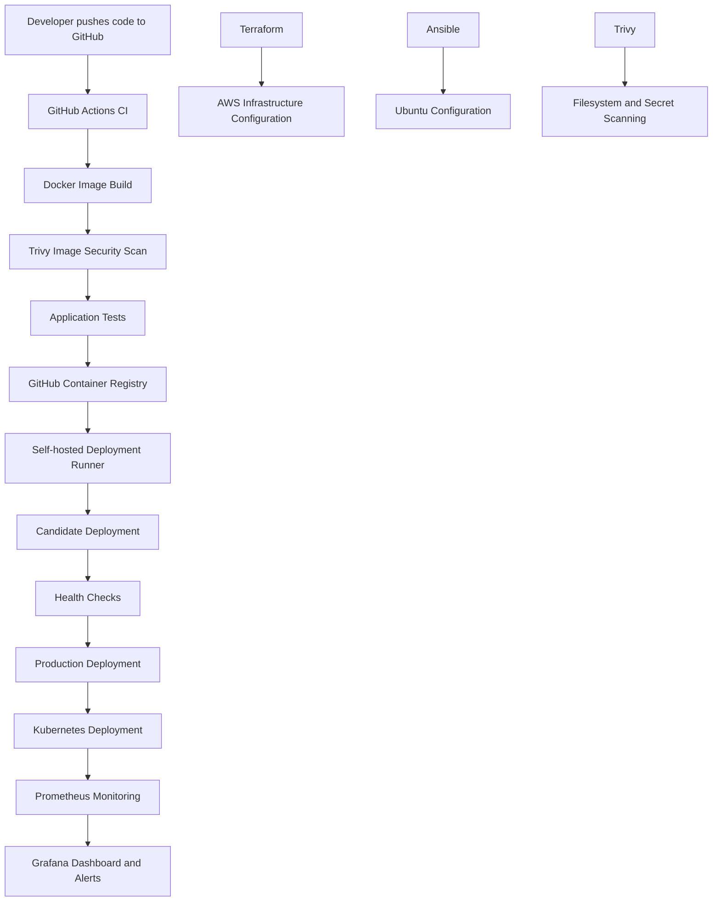

# Nexvion – End-to-End DevOps Project

## Overview

Nexvion is a web application used to demonstrate an end-to-end DevOps workflow. The project covers containerization, CI/CD automation, Infrastructure as Code, configuration management, Kubernetes orchestration, monitoring, and security scanning.

The project uses free and open-source tools and a local Ubuntu/Kind environment wherever possible.

## Technology Stack

| Area | Tools |
|---|---|
| Application | HTML, CSS, JavaScript |
| Containerization | Docker, Docker Compose |
| CI/CD | GitHub Actions, GitHub Container Registry |
| Infrastructure as Code | Terraform |
| Configuration Management | Ansible |
| Orchestration | Kubernetes, Kind |
| Monitoring | Prometheus, Grafana |
| Metrics and Probing | Node Exporter, Blackbox Exporter |
| Alerting | Prometheus Alert Rules, Alertmanager |
| Security | Trivy |
| Operating System | Ubuntu Linux |

## Architecture



## Phase 1 – Docker and CI/CD

- Containerized the Nexvion web application using Docker.
- Configured Docker Compose.
- Created a GitHub Actions CI/CD pipeline.
- Built and published the Docker image to GitHub Container Registry.
- Configured automated application tests.
- Implemented candidate deployment and production health checks.
- Added rollback handling for deployment failures.
- Used a self-hosted GitHub Actions runner for deployment.

## Phase 2 – Infrastructure as Code with Terraform

- Created Terraform configuration for AWS infrastructure.
- Configured an AWS security group in the eu-north-1 region.
- Used Terraform variables and outputs.
- Generated deployment information.
- Kept Terraform state and plan files out of Git.

Note: This phase demonstrates Terraform configuration. It does not represent a continuously running EC2 deployment.

## Phase 3 – Configuration Management with Ansible

- Configured Ansible to manage the Ubuntu host.
- Automated Nginx installation and configuration.
- Used an Ansible inventory and playbook.
- Used a Jinja2 template for application configuration.
- Verified playbook syntax and successful execution.
- Checked idempotency with a subsequent run.

## Phase 4 – Kubernetes Orchestration

- Created a local Kubernetes cluster using Kind.
- Created a dedicated Nexvion namespace.
- Configured a Kubernetes Deployment with two replicas.
- Created a ConfigMap and Service.
- Configured a NodePort service.
- Tested application availability using port forwarding.
- Performed a rolling restart.
- Simulated an image-pull failure and tested rollback.

The application pages returned HTTP 200 during verification.

## Phase 5 – Monitoring and Observability

Monitoring components:

- Prometheus – metrics collection.
- Node Exporter – host metrics.
- Blackbox Exporter – application availability checks.
- Grafana – monitoring dashboard.
- Alertmanager – alert routing.

Grafana dashboard panels:

1. CPU usage
2. Memory usage
3. Disk usage
4. Website availability
5. Website HTTP status

Configured alert rules:

- NexvionWebsiteDown
- HighCPUUsage
- HighMemoryUsage
- LowDiskSpace

Validated monitoring targets, simulated a website outage, observed the alert firing, and confirmed recovery.

Alertmanager uses local-only routing; external email and messaging notifications are not configured.

## Phase 6 – Security

Implemented Trivy security scanning through GitHub Actions.

### Filesystem and Secret Scanning

- Scans project files for vulnerabilities and exposed secrets.
- Checks HIGH and CRITICAL severity findings.
- Ignores unfixed vulnerabilities.
- Fails the workflow when matching findings are detected.

### Docker Image Scanning

- Scans operating-system and application-library vulnerabilities.
- Checks HIGH and CRITICAL severity findings.
- Runs as part of the CI/CD workflow and the dedicated security workflow.

Both jobs in the dedicated Nexvion Security Scan workflow completed successfully during verification.

Kubernetes demo secrets are placeholders only. Real credentials must never be committed to the repository.

## Deployment Verification

The project was tested using:

- Docker container health checks.
- HTTP checks for the home, products, and payment pages.
- Kubernetes rollout and rollback tests.
- Prometheus target and alert validation.
- Grafana dashboard verification.
- Trivy filesystem, secret, and image scans.

## Repository Structure

```text
Nexvion/
├── .github/
│   └── workflows/
│       ├── ci.yml
│       ├── ansible.yml
│       └── security.yml
├── ansible/
│   ├── inventory/
│   ├── playbooks/
│   └── templates/
├── kubernetes/
│   ├── namespace.yaml
│   ├── configmap.yaml
│   ├── deployment.yaml
│   └── service.yaml
├── site/
│   ├── index.html
│   ├── products.html
│   ├── payment.html
│   ├── CSS files
│   └── JavaScript files
├── terraform/
│   ├── main.tf
│   ├── variables.tf
│   └── outputs.tf
├── Dockerfile
├── compose.yaml
└── README.md
```

## Important Notes

- Terraform configuration does not imply that paid AWS resources are running.
- Kubernetes uses a local Kind cluster.
- Demo authentication and payment functionality are not production payment integrations.
- Secrets, Terraform state, and local plan files are excluded from version control.

## Project Outcome

Nexvion demonstrates an end-to-end DevOps workflow covering application containerization, automated delivery, infrastructure configuration, orchestration, observability, and security validation.
